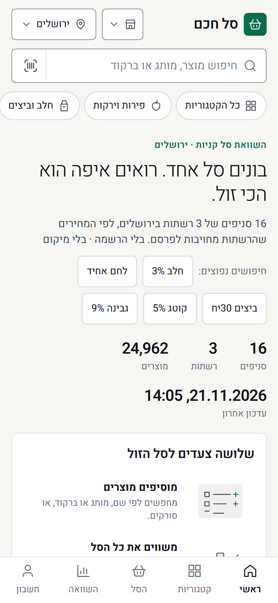
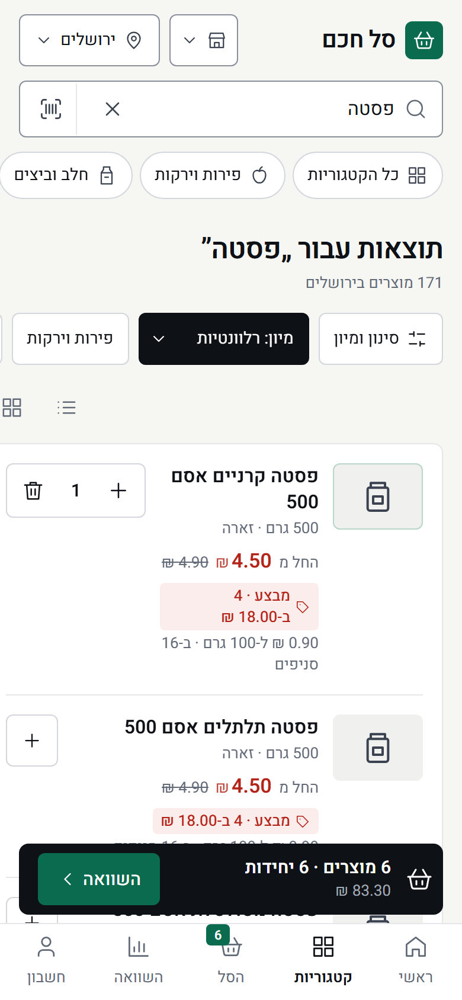
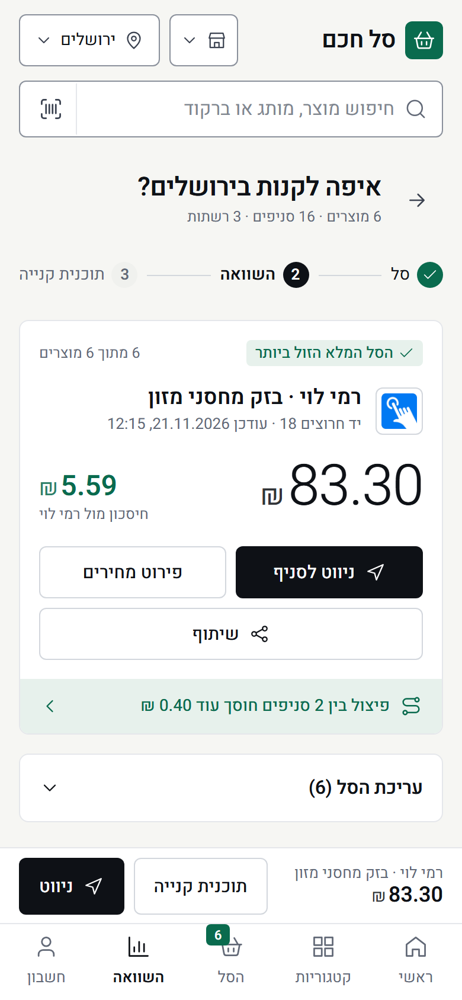

# סל חכם · Sal Haham

**עברית** · [English](#english)

אתר (PWA) שמשווה את המחיר של סל קניות שלם בין כל הסניפים בעיר שבחרתם, לפי הקבצים שרשתות המזון
בישראל מחויבות לפרסם לפי חוק המזון (2014). אין שרת: הנתונים הם קובצי Parquet סטטיים, והשאילתות
רצות בדפדפן עם DuckDB-WASM.

<p align="center">
  
  
  
</p>

## מה יש באתר

- בחירת עיר, חיפוש לפי שם או ברקוד, קטגוריות וסריקת ברקוד במצלמה.
- השוואת סל: כמה עולה כל הסל בכל סניף, מה חסר בכל סניף, וכמה חוסכים.
- תוכנית קנייה: סניף אחד, סל מפוצל בין 2 או 3 סניפים, או איזון בין מחיר לנוחות.
- מבצעים (כולל מבצעי מועדון, לפי בחירה), מחיר ל-100 גרם או לליטר, חלופות זולות והיסטוריית מחיר.
- עברית ואנגלית, מצב כהה, ועובד בלי רשת אחרי הטעינה הראשונה.
- הסל, המועדפים והרשימות נשמרים רק במכשיר. אין הרשמה ואין מעקב.

## התחלה מהירה

צריך [Bun](https://bun.sh) 1.4 ומעלה. הפקודות זהות ב-Windows, ב-macOS וב-Linux.

```sh
bun install
bun run demo-data       # נתוני בדיקה סינתטיים (מסומנים באתר) → web/public/data
bun run dev             # http://localhost:5173
```

## נתונים אמיתיים: `bun run update` ואז `bun run build`

```sh
bun run update          # מוריד מחירים ומבצעים מכל הרשתות הנתמכות → data/prices.duckdb → web/public/data
bun run build           # בונה את האתר → web/dist
bun run preview         # http://localhost:4173
```

עדכון ראשון של כל הארץ לוקח בערך 20 דקות (כ-1,900 סניפים, 11.5 מיליון מחירים) ומסד הנתונים מגיע
ל-1.5GB. לניסיון מהיר אפשר לקחת עיר אחת וכמה רשתות, וזה לוקח פחות מדקה:

```sh
bun run update -- --chains ramilevi,osherad,kingstore --city ירושלים
bun run build
```

`bun run update` לא מוריד פעמיים את אותו דבר:

- קובץ שכבר נטען למסד (`loaded_files`) לא יורד שוב. אם הקובץ המלא של סניף כבר נטען, יורדים רק קובצי
  העדכון הקטנים (`Price` / `Promo`) שפורסמו אחריו. `--no-deltas` מבטל את קובצי העדכון, `--updates`
  מוריד אותם גם אחרי קובץ מלא חדש, `--all` מוריד הכול מחדש.
- 4 רשתות נאספות במקביל (`--parallel N`), עם מגבלה של 6 הורדות בו-זמנית לכל אתר (`COLLECT_PER_HOST`).
  כל רשת נטענת למסד ברגע שסיימה לרדת. הטעינה באצוות של 25 קבצים בטרנזקציה (`INGEST_BATCH`).
- DuckDB משתמש כברירת מחדל בעד 8 ליבות ועד 4GB (`DUCKDB_THREADS` / `DUCKDB_MEMORY_LIMIT` קובעים במפורש).
- אם לא נטען שום קובץ חדש, אין ייצוא (`--force-export` מייצא בכל זאת, `--no-export` מדלג תמיד).
- `--no-promos` בלי מבצעים, `--promos-only` רק מבצעים, `--max-stores N` מגביל את מספר הסניפים לרשת.

העדכון הראשון ביום טוען קובץ מלא חדש לכל סניף (כ-0.6 שניות לקובץ). הטעינה, לא ההורדה, היא צוואר הבקבוק.

## איך זה עובד

```
cron (GitHub Actions / מחשב ביתי)
  → collect   הורדת Stores + PriceFull + PromoFull (+Price / Promo) מהפורטלים
  → ingest    gunzip/unzip → פענוח קידוד → SAX (saxes) → DuckDB      (הקובץ הגולמי נמחק)
  → export    Parquet (zstd, ממוין barcode,chain_id,store_id) לכל עיר + לכל הארץ
  → אחסון סטטי (GitHub Pages / R2 / כל שרת קבצים)
  → דפדפן     DuckDB-WASM: עיר = הורדה מלאה ושמירה offline; כל הארץ = HTTP Range
```

| תיקייה | מה יש בה |
|---|---|
| `src/collect` | הורדה מפורטלי המחירים של הרשתות |
| `src/ingest` | פענוח הקבצים, מסד DuckDB, ייצוא Parquet |
| `src/shared` | לוגיקה משותפת לצינור ולאתר: דירוג, מבצעים, קטגוריות, יחידות, חיפוש |
| `web` | האתר (Preact + Vite) |
| `scripts` | עדכון מלא, נתוני בדיקה, אייקונים, כלי עזר |
| `tests`, `e2e` | בדיקות יחידה (bun test) ובדיקות דפדפן (Playwright) |
| `data/ref` | רשימות היישובים של הלמ"ס (data.gov.il) |

## מקור הנתונים

| מנוע | רשתות | מימוש |
|---|---|---|
| Cerberus (`url.publishedprices.co.il`) | אושר עד, רמי לוי, יוחננוף, טיב טעם, קשת טעמים, פרש מרקט, סטופ מרקט, דור אלון, פוליצר, קופיקס, סאלח דבאח, סופר יודה, יילו | `src/collect/engines.ts` → `cerberus()` (ממשק ה-web: login + `file/json/dir`) |
| Bina (`{chain}.binaprojects.com`) | קינג סטור, זול ובגדול, סופר ברקת, סופר ספיר, שוק העיר, מעיין 2000, גוד פארם | `bina()` (`MainIO_Hok.aspx` + `Download.aspx`) |
| שופרסל (`prices.shufersal.co.il`) | שופרסל | `shufersal()` (טבלה עם עמודים, קישורי blob) |
| קרפור (`prices.carrefour.co.il`) | קרפור | `carrefour()` |
| אתרים ייעודיים | חצי חינם, סופר-פארם | `haziHinam()`, `superPharm()` |
| לא נתמך | ויקטורי, מחסני השוק, ח. כהן | האתר שלהן (laibcatalog) לא פרסם קובצי מחירים כשנבדק ב-19/11/2026 |

`bun run collect -- --list` מציג את הרשימה. שמות המשתמש והסיסמאות של Cerberus שבקוד הם הפרטים
הציבוריים מהרשימה הרשמית של משרד הכלכלה (gov.il/he/pages/cpfta_prices_regulations), לא סוד.

**חסימת IP.** נבדק ב-19/11/2026 מכתובת ישראלית: כל הפורטלים ענו. לא נבדק מכתובת בחו"ל. אם ה-runner של
GitHub נחסם, הגדירו runner בישראל (`vars.RUNNER`) או הריצו `bun run update` ממחשב ביתי ופרסו את `web/dist`.

### חריגות שמטופלות

| חריגה | איפה | דוגמה אמיתית |
|---|---|---|
| שמות תגים לא אחידים (`StoreId`/`StoreID`/`STOREID`/`asx:STOREID`) | `parser.ts`: שמות באותיות קטנות בלי namespace | שופרסל |
| UTF-8+BOM, UTF-16 (עם/בלי BOM), windows-1255/ISO-8859-8 | `decode.ts`: BOM → הצהרת XML → בדיקת UTF-8 תקין | קובצי Stores של רמי לוי/קרפור/יוחננוף הם UTF-16 |
| `.gz` שהוא בפועל ZIP | `decode.ts`: לפי magic bytes, fflate בהזרמה | |
| רווחים מיותרים, `לא ידוע` כערך | `parser.ts` `clean()`, `records.ts` `PLACEHOLDER` | רמי לוי: `ManufactureName=לא ידוע` |
| קוד עיר מספרי | `city.ts` `resolveCityName` + רשימת הלמ"ס | רמי לוי: `City=3000` → ירושלים |
| `City=0` | השם מוסק משם הסניף (מילה שלמה, ההתאמה הארוכה) | יוחננוף: "גן יבנה" → גן יבנה |
| `&` לא מקודד, `&nbsp;` | `parser.ts` `fixEntities()` (בזרם) | |
| יחידה ב-`UnitOfMeasure` במקום `UnitQty` | `units.ts` | רמי לוי: `UnitQty=לא ידוע, Quantity=1.32, UnitOfMeasure=ליטר` |

## Ingest

```sh
bun run ingest -- [--db data/prices.duckdb] [--keep] <קבצים או תיקיות>
```

- זרם: `fs → gunzip/unzip → iconv-lite → saxes → DuckDB Appender` ל-TEMP staging. אין DOM ואין
  טעינה של קובץ שלם לזיכרון.
- סכמה (`src/ingest/db.ts`): `stores`, `products` (barcode PK), `current_prices`, `price_history`,
  `promos`, `loaded_files` (sha256), `chains`, `meta`.
- מחירים באגורות (INTEGER). קוד פנימי (`ItemType=0`) נשמר כ-`chain:code`. ברקוד בלי אפסים מובילים.
- היסטוריה: שורה רק כשהמחיר משתנה. קובץ ישן שמגיע אחרי חדש לא דורס ולא נרשם.
- קובץ שכבר נטען (sha256) מדולג. קבצים גולמיים נמחקים אחרי טעינה (אלא אם `--keep`).
- מוצר שלא נראה 7 ימים לפני העדכון האחרון של הסניף לא מיוצא; סניף שלא עודכן 14 יום מסומן `stale`.
- מבצעים (`PromoFull` מחליף את מבצעי הסניף, `Promo` מעדכן): שורה לכל מבצע × פריט. הכללים ב-`src/ingest/promo.ts`:
  מחיר מבצע ("ב-9.90"), "N ב-X", "1+1", "בקנייה מעל X", מגבלת כמות, ומועדון (מסומן). לא נכללים: קופונים, מתנות,
  הטבות למצטרפים או לעובדים, "תו זהב", דילים שמורכבים מכמה סוגי פריטים, ומבצע לימים מסוימים בשבוע.

## Export

```sh
bun run export -- [--db data/prices.duckdb] [--out web/public/data] [--stale-days 7]
```

```
data/index.json                       ערים (+slug), רשתות, זמן עדכון, testData
data/cities/{slug}/stores.json
data/cities/{slug}/products.parquet   barcode, name, manufacturer, quantity, unit_qty, uom, is_weighted, search_key, n_stores, min_ag, max_ag
data/cities/{slug}/prices.parquet     barcode, chain_id, store_id, price_ag
data/cities/{slug}/promos.parquet     barcode, chain_id, store_id, club, min_qty, total_ag, max_qty, min_purchase_ag, ends, descr
data/cities/{slug}/history.parquet    שינויי מחיר לאורך זמן
data/all/…                            אותו דבר לכל הארץ
```

## האתר

- Preact + Vite. DuckDB-WASM נטען ברקע אחרי הציור הראשון, ובינתיים מוצג skeleton.
- עיר נבחרת ידנית עם השלמה אוטומטית (נרמול: קריית→קרית, בלי גרשיים ומקפים, "תל אביב-יפו"→"תל אביב").
  עיר בלי סניפים → הודעה + "חיפוש בכל הארץ". הבחירה והסל נשמרים ב-localStorage.
- סריקה: `BarcodeDetector` כשיש, ZXing (נטען רק כשצריך) כגיבוי. הסורק נשאר פתוח לסריקה רצופה.
- השוואה: קודם סניפים עם כל הסל לפי מחיר; אחריהם חלקיים לפי מספר המוצרים ואז מחיר. לכל סניף:
  כיסוי, מה חסר, וחיסכון לעומת הסניף היקר ביותר שיש בו **אותם** מוצרים.
- מבצעים: מבצע נכנס לסכום רק כשהכמות מתאימה ("2 ב-24" עם יחידה אחת = מחיר רגיל), "בקנייה מעל X" רק
  כששאר הסל בסניף מגיע לסכום, ומבצעי מועדון רק עם המתג "לכלול מבצעי מועדון". החישוב ב-`src/shared/promo.ts`.
- PWA: manifest ו-service worker (מעטפת, assets, נתוני העיר). אחרי טעינה ראשונה העיר והסל עובדים בלי רשת.

### אירוח עצמי של DuckDB

ה-wasm וה-worker של DuckDB נארזים עם האתר. את ה-Parquet extension DuckDB-WASM מוריד בשימוש הראשון
מ-`extensions.duckdb.org`. בלי תלות בשרת חיצוני:

```sh
bun run selfhost-duckdb                              # → web/public/duckdb/ext/...
VITE_DUCKDB_EXT_REPO=./duckdb/ext bun run build      # ב-PowerShell: $env:VITE_DUCKDB_EXT_REPO="./duckdb/ext"; bun run build
```

`VITE_DUCKDB_CDN=jsdelivr` טוען את ה-wasm מ-jsDelivr במקום מהאתר (שימושי באירוח שמגביל גודל קובץ).

## פריסה

- **מחשב ביתי או שרת**: `bun run update && bun run build`, ולהעלות את `web/dist` לכל אחסון סטטי.
  באירוח בתת-תיקייה: `BASE_PATH=/שם-התיקייה/`. לכתובות שיתוף מלאות: `VITE_PUBLIC_URL=https://הכתובת/`.
- **GitHub Pages**: `.github/workflows/update-data.yml` מריץ collect → ingest → export → build → deploy.
  מסד ה-DuckDB נשמר ב-actions/cache (בשביל ההיסטוריה). להפעיל Pages עם "GitHub Actions" כמקור, ולהריץ ידנית
  מלשונית Actions. לריצה אוטומטית 3 פעמים ביום מסירים את ההערה משורות ה-`schedule` בקובץ.
- **R2 / CDN**: להעלות את `web/dist/data` לדלי ציבורי עם CORS ו-Range, ולבנות עם `VITE_DATA_URL=https://…/data/`.

## בדיקות

```sh
bun run typecheck
bun test tests          # שמות קבצים, קידודים, היסטוריה, מבצעים, דירוג, קטגוריות, pipeline, זיכרון
bun run test:memory     # 300 אלף מוצרים: שיא RSS של הפרסר
bunx playwright install chromium
bun run e2e             # Playwright, 390×844, מגע
```

נתוני הבדיקה (`scripts/gen-synthetic.ts`) מסומנים: מזהי רשת שמתחילים ב-999, "(נתוני בדיקה)" בשם הרשת,
ו-`<TestData>true</TestData>` שגורם לאתר להציג באנר. הם לא מחירים אמיתיים.

## מה עוד לא נעשה

- דמי משלוח והזמנת מינימום (הרשתות לא מפרסמות), התראות על ירידת מחיר, חשבון וסנכרון בין מכשירים.
- רדיוס לפי קואורדינטות ומפה (אין קואורדינטות בקבצים).
- ויקטורי, מחסני השוק וח. כהן (ראו בטבלה למעלה).
- נבדק באמולציה של מובייל (Playwright), לא על מגוון מכשירים אמיתיים.

## רישיון וקרדיטים

הקוד ברישיון [MIT](LICENSE). כמה דברים במאגר שייכים לאחרים ואינם תחת MIT:

- **מחירים ומבצעים**: מתפרסמים על ידי הרשתות לפי תקנות שקיפות המחירים. הפרויקט לא קשור לאף רשת,
  והמחירים מוצגים כפי שפורסמו. ייתכנו טעויות, והמחיר הקובע הוא המחיר בחנות.
- **תמונות מוצר** (`web/public/img/p`): [Open Food Facts](https://world.openfoodfacts.org), רישיון CC BY-SA 3.0.
  המקור של כל תמונה ב-`index.json` שבאותה תיקייה.
- **לוגואים של רשתות** (`web/public/img/chains`): סימני מסחר של הרשתות, מוצגים רק כדי לזהות אותן.
  המקור של כל לוגו ב-`index.json` שבאותה תיקייה.
- **גופן**: [Heebo](https://fonts.google.com/specimen/Heebo), רישיון SIL OFL 1.1 (`web/src/fonts/OFL.txt`).
- **רשימות יישובים**: הלמ"ס דרך data.gov.il.

---

<a id="english"></a>

## English

**Sal Haham** ("smart basket") is a static web app (PWA) that compares the price of a whole grocery basket
across every supermarket branch in an Israeli city. It uses the price files that Israeli food chains must
publish under the 2014 Food Law. There is no backend: a Bun pipeline downloads the files into DuckDB and
exports Parquet files, and the browser queries them with DuckDB-WASM.

Features: city picker, search by name or barcode, categories, camera barcode scanner, basket comparison
with missing items and savings per branch, a shopping plan (one branch, or a basket split across 2 or 3
branches), promotions including optional club deals, unit prices, cheaper substitutes, price history,
Hebrew and English, dark mode, and offline use. The basket and lists stay on the device.

### Quick start

Requires [Bun](https://bun.sh) 1.4 or newer.

```sh
bun install
bun run demo-data       # synthetic test data, clearly marked in the UI
bun run dev             # http://localhost:5173
```

### Real prices: `bun run update`, then `bun run build`

```sh
bun run update          # download prices and promotions from all supported chains
bun run build           # build the site into web/dist
bun run preview         # http://localhost:4173
```

The first country-wide update takes about 20 minutes (about 1,900 branches and 11.5 million prices) and
the DuckDB file grows to about 1.5 GB. Later runs fetch only new files and take a minute or two. For a
quick try, one city and a few chains take under a minute:

```sh
bun run update -- --chains ramilevi,osherad,kingstore --city ירושלים
bun run build
```

Useful flags: `--chains a,b`, `--city NAME`, `--max-stores N`, `--no-promos`, `--promos-only`, `--all`
(download everything again), `--parallel N`, `--no-export`, `--force-export`. `bun run collect -- --list`
lists the chains. The price portals may block addresses outside Israel, so run the update from an Israeli
address if downloads fail.

### Deploy

`web/dist` is a plain static site and works on any static host. Set `BASE_PATH=/folder/` when hosting in a
sub-folder and `VITE_PUBLIC_URL=https://your-site/` for full share links. The workflow in
`.github/workflows/update-data.yml` runs the whole pipeline and deploys to GitHub Pages. It runs on manual
trigger; uncomment its `schedule` lines to run it three times a day.

By default the browser downloads DuckDB's Parquet extension from `extensions.duckdb.org` on first use. To
serve it from your own site, run `bun run selfhost-duckdb` and build with `VITE_DUCKDB_EXT_REPO=./duckdb/ext`.

### Tests

```sh
bun run typecheck
bun test tests
bunx playwright install chromium
bun run e2e
```

### License and credits

The code is under the [MIT license](LICENSE). Some content belongs to others and is not covered by MIT:
prices and promotions are published by the chains under the price transparency regulations; product photos
come from [Open Food Facts](https://world.openfoodfacts.org) (CC BY-SA 3.0, sources in
`web/public/img/p/index.json`); chain logos are trademarks of their owners and are shown only to identify
the chains; the Heebo font is under the SIL OFL 1.1; the city lists come from the Israeli Central Bureau
of Statistics through data.gov.il.

This project is not affiliated with any chain. Prices are shown as published and may contain errors. The
price in the store is the one that counts.
